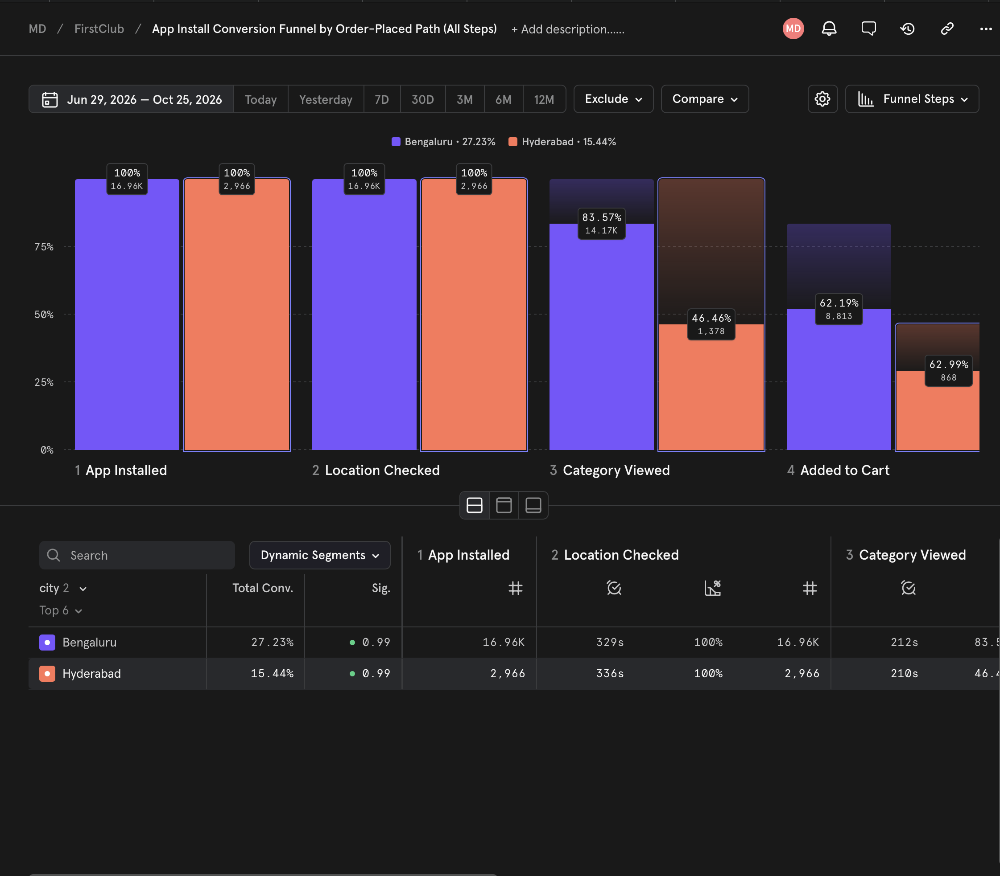
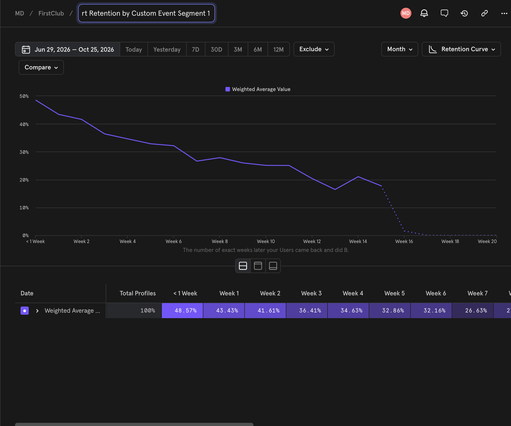

# FirstClub: Making the First 90 Days Stick

**A go-to-market plan to turn first-time FirstClub buyers into weekly regulars, with the tracking, SQL and A/B test design to measure it.**

> ⚠️ **All customer data here is simulated.** FirstClub's data isn't public. The event stream is generated to match public FirstClub figures and real grocery habit patterns, so the pipeline can be built and tested end to end. The numbers from simulated data describe the model, not FirstClub's actual performance.

## The problem (from public sources)

- About **30%** of FirstClub customers don't come back after their first purchase ([StartupTalky](https://startuptalky.com/news/firstclub-accelerates-expansion-plans/)).
- New users report **premium intimidation** and unfamiliar brands, while **fresh produce** is what wins repeat intent ([first-order review](https://dishabhatia.substack.com/p/i-tried-firstclub-and-these-are-my)).
- Onboarding leans on **free gifts on the first three orders**, which may not scale ([same review](https://dishabhatia.substack.com/p/i-tried-firstclub-and-these-are-my)).
- Public app reviews flag **subscription and quality slips**, which hurt a brand built on trust ([App Store](https://apps.apple.com/in/app/firstclub-quality-in-minutes/id6744534743?see-all=reviews&platform=iphone), [StartupChai](https://startupchai.substack.com/p/can-firstclub-scale-trust)).

## The insight (from real data)

In my [grocery retention analysis](https://github.com/mayankdalmia9-cmyk/grocery-retention-sql) of 1.47M real transactions:
- Households with **3+ trips in their first 28 days** were **2.3× as likely** to become regulars (74% vs 33%).
- At the same trip frequency, early **produce buyers** were **6–12 points** more likely to stay.

## The strategy

Replace part of the gift-led onboarding with a **produce-led journey** that aims for a **3rd order within 28 days**:
- Keep the order-1 gift.
- Swap the order-2 and order-3 gifts for a ₹60 produce credit on order 2.
- Add freshness-proof messaging and a "make it weekly" nudge.

Full journey spec, in the CleverTap/WebEngage structure: [`journey/produce_led_onboarding_journey.md`](journey/produce_led_onboarding_journey.md)

## What the analysis shows

| Question | Answer | Basis |
|---|---|---|
| How big a test is needed? | **~2,450 buyers per arm** to detect +4 pts on 3rd-order-in-28-days (80% power, 5% significance) | Simulated baseline 47.4% |
| How long will it take? | **~1.7 weeks** of enrolment + 28 days ≈ **6 weeks** | Public: ~170K households in year one ≈ 3,270/week |
| Is it cheaper? | Produce-led costs **₹194 vs ₹343** per new buyer, saving **₹149** | Assumed ₹150 gift, ₹60 credit |
| What lift does it need to pay off? | It breaks even even if the 3rd-order rate **falls by up to 7.4 pts** (range 3–16 pts across cost and margin assumptions) | Assumed 15% contribution margin; sensitivity in `results/07_breakeven.csv` |
| Can the readout be trusted? | On test data with a **planted ~+4 pt effect**, the readout query found **+5.6 pts (95% CI +2.8 to +8.3)**, which contains the true value | `sql/05_experiment_readout.sql` |

## Tools

- **Mixpanel:** 107,683 simulated events, 7 event types. Import with `sim/upload_to_mixpanel.py`, then build:
  - **Funnel:** App Installed → Location Checked → Category Viewed → Added to Cart → Signed Up → Order Placed
  - **Retention report:** first Order Placed → any Order Placed, weekly
- **SQL (SQLite):** funnel, repeat ladder, weekly cohorts, gift cost and experiment readout (`sql/`).
- **CleverTap / WebEngage:** journey designed to their spec format. These tools need a business account, so it's specified, not deployed.




## Files

| Path | What |
|---|---|
| `sim/simulate.py` | Seeded simulation (`--planted-test` builds the A/B validation data) |
| `sim/upload_to_mixpanel.py` | Sends the events to your Mixpanel project |
| `sql/01–05` | Funnel, repeat ladder, weekly cohorts, gift cost, experiment readout |
| `analysis/power_and_breakeven.py` | Sample size, test duration, break-even sensitivity |
| `journey/` | Produce-led onboarding journey spec |
| `results/` | All outputs as CSV |

## Calibration and assumptions

| Input | Value | Source |
|---|---|---|
| Average order value | ~₹1,200 | Public (TechCrunch, StartupTalky) |
| Return after first purchase | ~70% (sim: 73% within 90 days) | Public (StartupTalky) |
| Orders per active customer | 4+ a month (sim: ~4.3) | Public (TechCrunch) |
| New households | ~170K in year one | Public (TechCrunch) |
| Habit shape, produce effect | Direction from real grocery data | Complete Journey analysis |
| Funnel conversion rates, serviceability by locality, gift cost (₹150), produce credit (₹60), margin (15%) | Assumptions | Labelled; change them in `sim/simulate.py` and `analysis/` |

## Run it

```bash
python run_all.py                                   # regenerate data, run SQL, power + break-even
python sim/upload_to_mixpanel.py YOUR_PROJECT_TOKEN # optional: send events to Mixpanel
```
